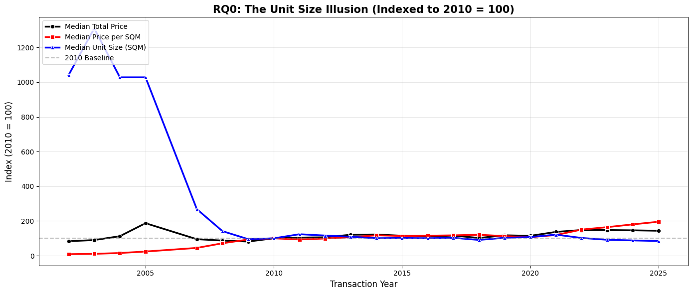
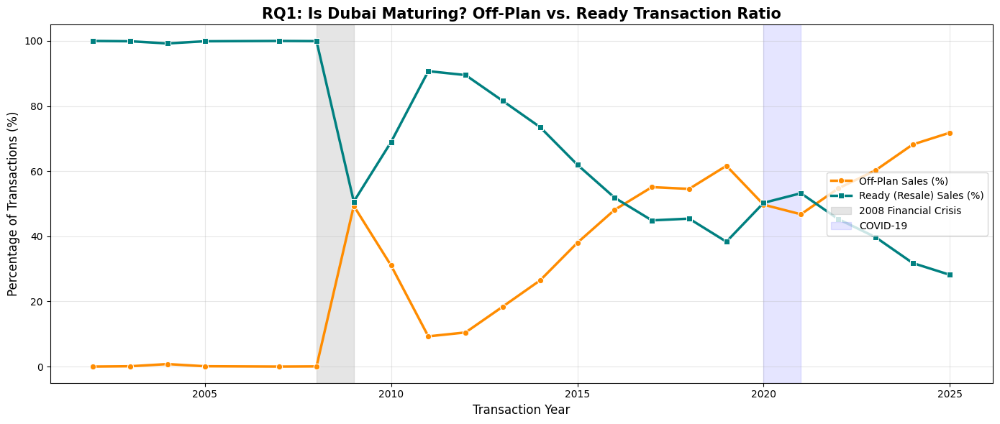
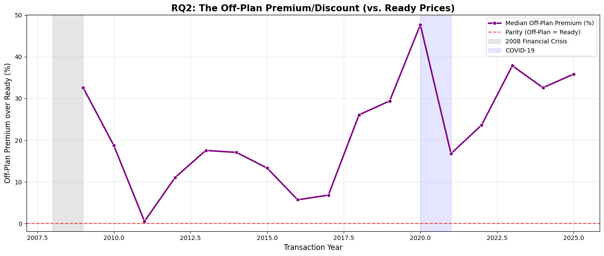
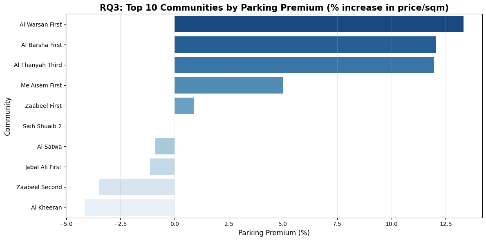

#  Dubai Real Estate Market Microstructure & AI Valuation Engine

[](https://www.python.org/)
[](https://pandas.pydata.org/)
[](https://scikit-learn.org/)
[](https://opensource.org/licenses/MIT)

**An end-to-end Data Analytics and Machine Learning project analyzing 1.09 million government-registered real estate transactions (Dubai Land Department, 2004–2026).**

---

##  Executive Summary
Dubai’s real estate market is widely reported to be maturing into a stable, end-user market. However, an empirical analysis of 1.09M transaction-level records reveals a different reality. The market is fragmenting: off-plan speculation is surging, unit sizes are shrinking, and extreme micro-level pricing anomalies exist in prime districts. This project uses robust statistical analysis and a Random Forest valuation engine to uncover these hidden risks and identify undervalued assets.

---

##  Table of Contents
- [Executive Summary](#-executive-summary)
- [Data & Methodology](#️-data--methodology)
- [The 5 Key Findings](#-the-5-key-findings)
- [The Machine Learning Engine](#-the-machine-learning-engine-mispricing-detection)
- [Repository Structure](#-repository-structure)
- [Tech Stack & Skills](#-tech-stack--skills-demonstrated)
- [How to Reproduce](#-how-to-reproduce-this-project)
- [Limitations & Future Work](#️-limitations--future-work)

---

##  Data & Methodology
- **Source:** Dubai Land Department (DLD) open data (via Hugging Face).
- **Scale:** 1,382,848 raw records.
- **Cleaning Pipeline:** 
  * Filtered `quality_flags = 0` to remove P1-P99 extreme outliers and bad dates (retaining 1,354,155 rows).
  * Excluded `Land` and `Building` types (wholesale/plot sales distort price-per-sqm metrics).
  * Excluded `Commercial` usage, isolating only built `Residential` Units and Villas.
- **Final Dataset:** **1,094,417** pristine transactions spanning 1993–2026.
- **Statistical Rigor:** Uses **Medians** (not averages) to prevent ultra-luxury outliers (e.g., penthouse sales) from skewing market trends.

---

##  The 5 Key Findings

### Finding 1: The Unit Size Illusion (RQ0)
*The Hook:* Market headlines claim Dubai property prices have doubled since 2010. The data shows total transaction prices have remained relatively flat, but the **median unit size has shrunk by ~40%**. Buyers are paying the same total capital for significantly less space, artificially inflating the "price per sqm" metric.

<p align="center">
  
</p>

### Finding 2: The "Mature Market" Myth (RQ1)
Dubai claims to have transitioned into a mature, end-user market. However, the off-plan (pre-construction) transaction ratio has surged from just **10% in 2012 to a staggering 72% in 2025**. The market has reverted to a pre-2008, construction-driven speculative cycle, not a mature resale market.

<p align="center">
  
</p>

### Finding 3: The Off-Plan Distress Signal (RQ2)
While the city-wide median off-plan premium sits at **+35%**, micro-level analysis reveals severe divergence. In prime, established districts such as **Zaabeel First (-33.1%)** and **Trade Center First (-19.7%)**, developers are aggressively dumping new inventory at a discount compared to ready properties. This is an early-warning stress signal of demand saturation in ultra-prime areas.

<p align="center">
  
</p>

### Finding 4: The "Car-Dependent" Parking Premium (RQ3a)
Parking is not a universal amenity. It commands a massive **+13% price premium** in sprawling, car-dependent suburbs like **Al Warsan First** and **Al Barsha First**. Conversely, in dense, older, or walkable districts (e.g., Al Satwa), parking adds negligible value.

<p align="center">
  
</p>

### Finding 5: The "Family Haven" Bedroom Premium (RQ3b)
By mapping the price-per-sqm spread between 1BR and 2BR units, we pinpoint exact buyer profiles. In family suburbs like **Wadi Al Safa 4**, 2-bedroom units command a **30% higher price/sqm** than 1-bedrooms. Conversely, in investor-heavy zones, 1-bedrooms hold the premium.

<p align="center">
  
</p>

---

##  The Machine Learning Engine (Mispricing Detection)
Built a **Random Forest Regressor** to predict the *fair expected price per sqm* based on community, property type, bedrooms, parking, registration type, and market year.

- **Model Accuracy ($R^2$):** **0.64** (Strong for real estate given market volatility)
- **Mean Absolute Error (MAE):** **3,459 AED/sqm**
- **Sanity Filtering:** The model explicitly removes "partial sales" and parking-space anomalies (by filtering `area >= 30sqm` and `price_aed >= 200,000`).

**Application:** By comparing actual transaction prices against model predictions, the engine successfully flagged real-world properties (e.g., 1BR in Ocean Heights, 3BR in Murjan) trading at a **35% discount to fair value**. 

<p align="center">
  
</p>

**Top Undervalued Deals Detected by the AI:**
| Date | Community | Building | Beds | Price (AED) | Price/sqm | AI Fair Value | Discount |
| :--- | :--- | :--- | :--- | :--- | :--- | :--- | :--- |
| 2021-05-27 | Marsa Dubai | Ocean Heights | 1 | 980,000 | 10,028 | 15,427 | **35.0%** |
| 2021-01-27 | Business Bay | Elite Business Bay | 1 | 830,000 | 9,854 | 15,160 | **35.0%** |
| 2019-09-03 | Marsa Dubai | Murjan 5 | 3 | 1,650,000 | 9,436 | 14,516 | **35.0%** |
| 2025-06-02 | Marsa Dubai | Elite Residence | 2 | 1,840,000 | 14,899 | 22,920 | **35.0%** |

*(Note: The exact 35.0% is a result of filtering the top deals at the 35% discount ceiling).*

---

##  Repository Structure
```text
Dubai_Real_Estate_Analytics/
│
├── data/
│   ├── README.md                  # Data source instructions
│   ├── raw/                       # (Gitignored) Raw Parquet file
│   └── processed/                 # (Gitignored) Cleaned Parquet file
│
├── src/
│   ├── loader.py                  # Downloads and loads Parquet data
│   ├── cleaning.py                # Strict filtering based on DLD quality flags
│   ├── visualization.py           # Reusable chart styling
│   ├── analysis.py                # RQ0 to RQ3 statistical analysis functions
│   └── models.py                  # ML pipeline (training, evaluation, residual analysis)
│
├── notebooks/
│   ├── 01_Four_Research_Questions.ipynb  # EDA and business findings
│   └── 02_ML_Mispricing_Detection.ipynb  # Random Forest valuation model
│
├── visualizations/                # Exported PNG charts
├── requirements.txt               # Dependencies
├── .gitignore                     # Excludes large data files
└── README.md                      # Project overview (this file)
```

---

##  Tech Stack & Skills Demonstrated

**Data Engineering & Wrangling:**
* `Pandas` (Advanced grouping, pivoting, time-series extraction)
* `PyArrow` (High-performance Parquet file handling)
* Data Cleaning (Handling missing values, filtering quality flags, outlier removal)

**Machine Learning & Statistics:**
* `Scikit-Learn` (Random Forest Regression, ColumnTransformer, Pipelines)
* Feature Engineering (One-Hot Encoding, Target isolation)
* Model Evaluation ($R^2$, Mean Absolute Error, Anomaly Detection)

**Data Visualization:**
* `Matplotlib` & `Seaborn` (Custom line charts, dual-axis plots, horizontal bar charts)

---

##  How to Reproduce This Project

**1. Clone the repository:**
```bash
git clone https://github.com/your-username/Dubai_Real_Estate_Analytics.git
cd Dubai_Real_Estate_Analytics
```

**2. Install dependencies:**
```bash
pip install -r requirements.txt
```

**3. Download the Data:**
Download the `dld_sales_transactions.parquet` file from [Hugging Face](https://huggingface.co/datasets/dubairealestatedata/dubai-real-estate-sales-transactions) and place it in the `data/raw/` folder.

**4. Run the data pipeline:**
Execute the cleaning script to process the 1.38M raw records and generate the analysis-ready dataset:
```bash
python src/cleaning.py
```

**5. Explore the findings:**
Open the Jupyter Notebooks to view the charts and machine learning model:
- `notebooks/01_Four_Research_Questions.ipynb` (EDA & Market Insights)
- `notebooks/02_ML_Mispricing_Detection.ipynb` (Random Forest Valuation)

---

##  Limitations & Future Work
While this analysis is robust, there are inherent limitations in the dataset that present opportunities for future iterations:
* **No Unique Property ID:** The DLD dataset does not provide a unique `property_id`. As a result, RQ1 tracks *building-level* turnover (velocity) rather than exact property holding periods.
* **2026 Incomplete Data:** The dataset snapshot ends on November 2, 2026. Therefore, 2026 figures are excluded from the time-series charts to prevent partial-year distortions.
* **Text Normalization:** `building_name` and `project_name` are free-text fields with spelling variations. Future work includes applying fuzzy string matching (e.g., `RapidFuzz`) to group building names more accurately.

---
*Data Source: Dubai Land Department (DLD) via Dubai Pulse. This project is for analytical and portfolio purposes and does not constitute investment advice.*

---

<div align="center">

  ###  Engineered by **Anandhu Suresh**
  *Data Analyst & Machine Learning Practitioner — **Questions First. Numbers Second.***
  
  <p align="center">
    Turning 1M+ row datasets into market-moving intelligence, statistical insights, and predictive engines.<br>
    Always open to collaborating on high-impact data analytics, ML pipelines, and new opportunities.
  </p>

  <a href="https://www.linkedin.com/in/anandhu-suresh-in/" target="_blank">
    
  </a>
  &nbsp;&nbsp;
  <a href="mailto:anandhu.suresh.dev@gmail.com">
    
  </a>

</div>