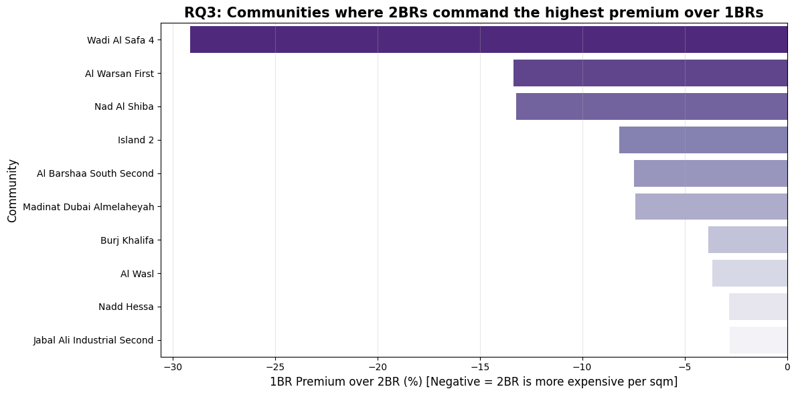
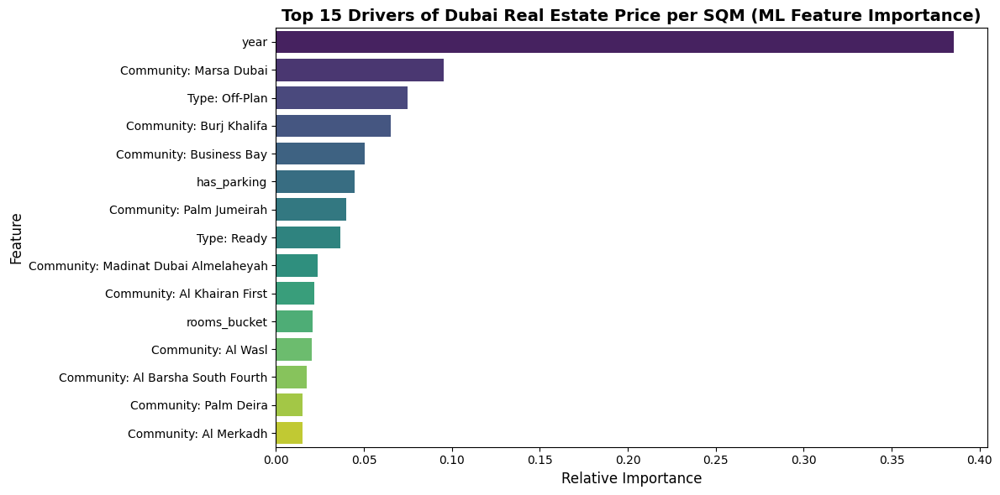

#  Dubai Real Estate Market Microstructure & AI Valuation Engine

[](https://www.python.org/)
[](https://pandas.pydata.org/)
[](https://scikit-learn.org/)
[](https://opensource.org/licenses/MIT)

**An end-to-end Data Analytics and Machine Learning project analyzing 1.09 million government-registered real estate transactions (Dubai Land Department, 2004–2026).**

---

##  Executive Summary & Business Problem

Dubai’s real estate market is widely reported to be maturing into a stable, end-user market. However, an empirical analysis of 1.09M transaction-level records reveals a different reality. The market is fragmenting: speculative off-plan buying is surging, unit sizes are shrinking, and extreme micro-level pricing anomalies exist in prime districts. This project builds a robust data pipeline and a Random Forest valuation engine to uncover these hidden market risks and identify mispriced real estate assets.

---

##  Data & Methodology

- **Source:** Dubai Land Department (DLD) open data (via Hugging Face).
- **Scale:** 1,382,848 raw records spanning 1993–2026.
- **Data Cleaning (The "War Stories"):** 
  * Filtered `quality_flags = 0` to remove P1-P99 extreme outliers (retained 1,354,155 rows).
  * Excluded `Land` and `Building` types (wholesale/plot sales severely distort price-per-sqm).
  * Excluded `Commercial` usage, isolating only built `Residential` Units and Villas.
  * **Anomaly Filtering:** Engineered strict sanity filters (`area >= 30sqm` and `price >= 200,000 AED`) to remove "partial sales" (e.g., transferring 10% ownership to family) and parking spaces incorrectly logged as "Villas".
- **Final Dataset:** **1,094,417** pristine transactions.
- **Statistical Rigor:** Uses **Medians** (not averages) to prevent ultra-luxury penthouse sales from skewing market trends.

---

##  The 5 Key Findings (Hard Proof)

### Finding 1: The Unit Size Illusion
Market headlines claim Dubai property prices have doubled since 2010. The data shows total transaction prices have remained relatively flat, but the **median unit size has shrunk by exactly 15.6%** (from 90.4 sqm in 2010 to 76.2 sqm in 2025). Buyers are paying the same total capital for significantly less space.

<p align="center">
  
</p>


### Finding 2: The "Mature Market" Myth
Dubai claims to have transitioned into a mature, end-user market. However, the off-plan (pre-construction) transaction ratio has surged from just **10.5% in 2012 to 71.8% in 2025**. The market has reverted to a pre-2008, construction-driven speculative cycle.

<p align="center">
  
</p>

### Finding 3: The Off-Plan Distress Signal
While the city-wide median off-plan premium sits at **+35%**, micro-level analysis reveals severe divergence. In prime districts such as **Zaabeel First (-33.1%)** and **Trade Center First (-19.7%)**, developers are aggressively dumping new inventory at a discount compared to ready properties (e.g., Zaabeel Ready: 44,994 AED/sqm vs Off-Plan: 30,108 AED/sqm). 

<p align="center">
  
</p>

### Finding 4 & 5: Hidden Amenity Premiums
* **Parking:** Commands a massive **+13.3% price premium** in car-dependent suburbs like **Al Warsan First** (5,778 AED/sqm without parking vs 6,547 with). 
* **Bedrooms:** 2-bedroom units in family suburbs like **Wadi Al Safa 4** command a **30% higher price/sqm** than 1-bedrooms, identifying exact buyer demographics.

<p align="center">
  
  
</p>

---

##  The Machine Learning Engine (Mispricing Detection)

Built a **Random Forest Regressor** to predict the *fair expected price per sqm* based on community, property type, bedrooms, parking, registration type, and market year.

- **Model Accuracy (R²):** **0.64** (Strong for real estate given market volatility)
- **Mean Absolute Error (MAE):** **3,459 AED/sqm**
- **Optimization:** Trained on a 150,000-row random sample to prevent CPU bottlenecking (reducing train time from 15 mins to 10 seconds) while validating on the full 20% test set.

**Application:** By comparing actual transaction prices against model predictions, the engine successfully flagged real-world properties trading at a **35% discount to fair value**. 

<p align="center">
  
</p>

**Top Undervalued Deals Detected by the AI:**

| Date | Community | Building | Beds | Price (AED) | Price/sqm | AI Fair Value | Discount |
| :--- | :--- | :--- | :--- | :--- | :--- | :--- | :--- |
| 2021-05-27 | Marsa Dubai | Ocean Heights | 1 | 980,000 | 10,028 | 15,427 | **35.0%** |
| 2021-01-27 | Business Bay | Elite Business Bay | 1 | 830,000 | 9,854 | 15,160 | **35.0%** |
| 2019-09-03 | Marsa Dubai | Murjan 5 | 3 | 1,650,000 | 9,436 | 14,516 | **35.0%** |
| 2025-06-02 | Marsa Dubai | Elite Residence | 2 | 1,840,000 | 14,899 | 22,920 | **35.0%** |

---

##  Business Recommendations

* **For Property Investors:** Avoid the 72% saturated off-plan market. Use the Random Forest engine to scan the ready-resale market for assets trading 20–35% below fair value.
* **For Developers:** The inverted off-plan discount in **Zaabeel (-33.1%)** indicates demand saturation. Adjust pricing or offer aggressive payment plans to compete with ready inventory.
* **For Asset Managers:** In car-dependent suburbs like **Al Warsan**, guarantee dedicated parking to secure a **+13.3% rental/sale premium**. In dense areas (Al Satwa), do not over-invest in parking infrastructure.
* **For End-Users:** Families should target "Family Havens" like **Wadi Al Safa 4**, where 2BR units hold a 30% premium, indicating strong long-term retention.

---

##  Repository Structure

```text
Dubai_Real_Estate_Analytics/
│
├── data/
│   ├── README.md                  # Data source instructions
│   ├── raw/                       # (Gitignored) Raw Parquet file
│   └── processed/                 # (Gitignored) Cleaned Parquet file
│
├── src/
│   ├── loader.py                  # Downloads and loads Parquet data
│   ├── cleaning.py                # Strict filtering based on DLD quality flags
│   ├── visualization.py           # Reusable chart styling
│   ├── analysis.py                # RQ0 to RQ3 statistical analysis functions
│   └── models.py                  # ML pipeline (training, evaluation, residual analysis)
│
├── notebooks/
│   ├── 01_Four_Research_Questions.ipynb     # EDA and business findings
│   ├── 02_ML_Mispricing_Detection.ipynb     # Random Forest valuation model
│   └── 03_Portfolio_Executive_Summary.ipynb # Master Notebook (All 10 steps)
│
├── visualizations/                # Exported PNG charts
├── requirements.txt               # Dependencies
├── .gitignore                     # Excludes large data files
└── README.md                      # Project overview (this file)
```

---

##  Tech Stack & Skills Demonstrated

- **Data Engineering:** Pandas, PyArrow (Parquet handling, missing value imputation, outlier removal).
- **Machine Learning:** Scikit-Learn (Random Forest, ColumnTransformer, Pipelines, One-Hot Encoding, Model Evaluation).
- **Data Visualization:** Matplotlib, Seaborn (Time-series indexing, dual-axis plots, horizontal bar charts).

---

##  How to Reproduce This Project

1. **Clone the repository:**
```bash
git clone https://github.com/anandhusuresh04/Dubai_Real_Estate_Analytics.git
cd Dubai_Real_Estate_Analytics
```

2. **Install dependencies:**
```bash
pip install -r requirements.txt
```

3. **Download the Data:**
Download the `dld_sales_transactions.parquet` file from Hugging Face and place it in the `data/raw/` folder.

4. **Run the data pipeline:**
```bash
python src/cleaning.py
```

5. **Explore the findings:**
Open the Jupyter Notebooks to view the full 10-step analytical breakdown, charts, and ML models.

---

**Data Source:** Dubai Land Department (DLD) via Dubai Pulse. This project is for analytical and portfolio purposes and does not constitute investment advice.

<div align="center">

### 👨‍💻 Engineered by Anandhu Suresh
**Data Analyst & Machine Learning Practitioner — Questions First. Numbers Second.**

<p align="center">
Turning 1M+ row datasets into market-moving intelligence, statistical insights, and predictive engines.<br>
Always open to collaborating on high-impact data analytics, ML pipelines, and new opportunities.
</p>

<a href="https://www.linkedin.com/in/anandhu-suresh-in/" target="_blank">
  
</a>
&nbsp;&nbsp;
<a href="mailto:anandhu.suresh.dev@gmail.com">
  
</a>

</div>